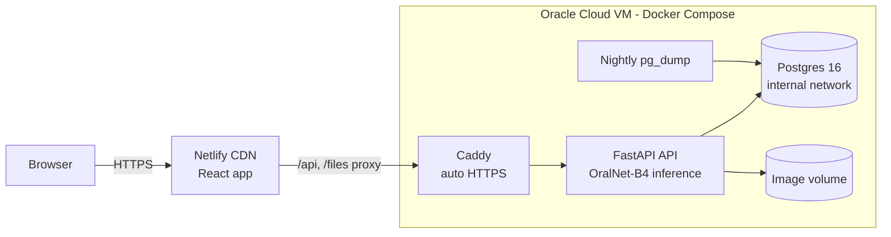

<div align="center">

# OralAID

**Explainable AI screening support for oral cancer and oral potentially malignant disorders.**

[**Live site: oral-cancer-detect.netlify.app**](https://oral-cancer-detect.netlify.app/)

[](https://github.com/Karthik-099/oral-cancer-detection/actions/workflows/deploy.yml)
[](https://oral-cancer-detect.netlify.app/)
[](LICENSE)

</div>

Upload an intraoral photo and OralAID returns a suspicion score, a risk tier and a
recommendation, and shows *why*: a Grad-CAM heatmap, an outlined region of
interest and LIME superpixel explanations. Clinicians record their own verdict
on every case, which feeds model evaluation and future retraining.

> **Medical disclaimer.** OralAID is clinical decision support for research and
> screening. It is not a diagnostic device, is not cleared by any regulator, and
> never replaces clinical examination or biopsy. Refer anything suspicious.

---

## Contents

- [What it does](#what-it-does)
- [The model, honestly](#the-model-honestly)
- [Architecture](#architecture)
- [Tech stack](#tech-stack)
- [Repository layout](#repository-layout)
- [Run it locally](#run-it-locally)
- [Deploy](#deploy)
- [Testing, CI/CD and security](#testing-cicd-and-security)
- [API](#api)
- [Roadmap](#roadmap)
- [Contributing](#contributing)
- [License](#license)

## What it does

| | |
|---|---|
| **Screening** | 1 to 6 photos per case, camera capture, crop-to-tissue tool, interactive mouth map for the anatomical site |
| **AI result** | Suspicion probability with uncertainty, Low / Moderate / High tier, clinical recommendation |
| **Explainability** | Grad-CAM heatmap, Grad-CAM-seeded GrabCut region outline, LIME superpixels on demand |
| **Image quality gate** | Sharpness, exposure and resolution checks; non-oral photos are rejected |
| **Clinical workflow** | Case statuses (open / referred / closed), clinician feedback, patient timelines, printable reports, CSV export |
| **Dashboard** | Volume by tier, score distribution, review queue, site heat map, agreement rate |
| **Platform** | Accounts, API keys for integrations, audit log, sign-out-everywhere, ⌘K command palette, dark/light themes |

## The model, honestly

| Model | Status | Notes |
|---|---|---|
| **OralNet-B4** (EfficientNet-B4 + MLP head) | Production | Binary: suspicious vs non-suspicious. Multi-scale (300/380 px) + flip test-time augmentation |
| **Region Localizer** (Grad-CAM -> GrabCut) | Production | Weakly supervised outline of what drove the prediction |
| MobileNetV2 (legacy) | Retired | Failed validation, AUC 0.41 |
| U-Net ResNet-34 (legacy) | Retired | Trained on whole-image pseudo-masks, so it marks the entire photo |

Measured with `python -m inference.evaluate` on specialist-labelled images:

| Metric | Value |
|---|---|
| Held-out validation accuracy (training split) | 76.8% |
| AUC (internal evaluation, 400 images) | 0.83 |
| Sensitivity / specificity at threshold 0.30 | 70.5% / 80.2% |
| PPV in the High tier (score >= 0.55) | 90% |

The internal evaluation set may overlap the training data, and independent external
validation is still pending. Grad-CAM also shows the model sometimes attends to
instruments or fingers (shortcut learning). That's why every result shows its
heatmap and the app offers a crop tool. Model weights and patient data are **not**
included in this repository.

## Architecture



- The website is static and served from Netlify's CDN. Netlify proxies `/api` and `/files` to the VM, so the browser only ever talks to one domain.
- On the VM, Caddy is the only public entry point. The API and Postgres sit on Docker networks, and the database network has no route out.
- Clinical images are served only through short-lived HMAC-signed URLs.

## Tech stack

| Layer | Technology |
|---|---|
| **ML / inference** | PyTorch 2.8, torchvision (EfficientNet-B4), OpenCV (GrabCut, quality checks), scikit-image (SLIC superpixels), scikit-learn (LIME surrogate), NumPy |
| **Backend** | Python 3.11, FastAPI, Uvicorn, Pydantic v2, SQLAlchemy 2, PostgreSQL 16 (SQLite for local dev), PyJWT, passlib/bcrypt |
| **Frontend** | React 18, TypeScript (strict), Vite 5, Tailwind CSS 3, Framer Motion (scroll and 3D animation), Lenis (smooth scrolling), Recharts, Zustand, React Router 6, lucide icons |
| **Design** | Chakra Petch + Space Grotesk + JetBrains Mono, gradient design tokens, dark/light themes |
| **Hosting** | Netlify (web, CDN, headers, proxy), Oracle Cloud VM (API) with Docker Compose and Caddy (Let's Encrypt HTTPS) |
| **CI/CD** | GitHub Actions: lint, tests, build, Docker smoke test, k6 load smoke, deploy to the VM over SSH |
| **Testing** | pytest + FastAPI TestClient, Vitest + Testing Library, k6, Locust, Apache Bench |
| **Security tooling** | gitleaks, Bandit, pip-audit, npm audit, CodeQL, Trivy, OWASP ZAP, Dependabot |

## Repository layout

```
oralaid_app/            FastAPI backend
  app_fastapi.py        API: auth, cases, patients, dashboard, keys, audit
  security.py           JWT, API keys, signed URLs, rate limiting, headers
  inference/            engine (classifier, Grad-CAM, LIME, localizer), registry, evaluation
  tests/                pytest suite (API, security, real-model tests)
frontend/               React + Vite web app
  src/pages/site/       marketing pages      src/pages/app/   clinical app
  src/components/       design system, 3D/scroll animation, clinical widgets
deploy/                 Dockerfile, docker-compose (Caddy, API, Postgres, backups), Oracle VM scripts
loadtests/              k6, Locust and ab scripts
.github/workflows/      CI, security, deploy, load test
netlify.toml            web hosting, caching and security headers
```

The `src/`, `notebooks/` and `tool/` folders hold the original research code (training, annotation tool).

## Run it locally

You need Python 3.11, Node 22 and the model checkpoint `final_efficientnet_b4_oral_cancer.pth` in `models/`.

```bash
# Backend: http://localhost:8000 (API docs at /docs)
cd oralaid_app
pip install -r requirements-dev.txt --extra-index-url https://download.pytorch.org/whl/cpu
uvicorn app_fastapi:app --reload --port 8000

# Frontend: http://localhost:5173 (proxies /api to :8000)
cd frontend
npm ci
npm run dev
```

Without the checkpoint, the app still runs; analyses return 503 until weights are available.

## Deploy

- **Website:** Netlify builds `frontend/` from the `prod` branch using `netlify.toml`. Set `ORALAID_API_ORIGIN` to the API URL.
- **API:** an Oracle Cloud VM running `deploy/docker-compose.yml`. One-time setup with `deploy/oracle/setup.sh`; every push to `prod` redeploys over SSH.

Step-by-step instructions: **[DEPLOYMENT.md](DEPLOYMENT.md)**.

## Testing, CI/CD and security

| Workflow | When | What |
|---|---|---|
| `ci.yml` | push to `main`, PRs | ruff, pytest, TypeScript, Vitest, production build + bundle budget, Docker image smoke test, k6 SLO smoke |
| `security.yml` | push to `main`, PRs, weekly | gitleaks, Bandit, pip-audit, npm audit, CodeQL, Trivy (critical CVEs), OWASP ZAP API scan |
| `deploy.yml` | push to `prod` | runs CI + security, then deploys the API to the Oracle VM and health-checks it |
| `load-test.yml` | manual | k6 (smoke / load / stress / spike) and Locust against any URL |

Security in the app itself:
- bcrypt password hashing and a password policy
- account lockout and per-IP / per-user rate limits
- JWT sessions with revocation; API keys stored only as hashes
- HMAC-signed, expiring image URLs and an audit log
- strict CSP and HSTS headers
- upload checks that sniff file contents rather than trusting the extension
- checksum-verified model downloads, loaded with `weights_only`

Please report vulnerabilities privately; see [SECURITY.md](SECURITY.md).

## API

All endpoints are under `/api` and documented at `/docs` (OpenAPI) when enabled.

| Method | Endpoint | Purpose |
|---|---|---|
| POST | `/auth/register`, `/auth/login` | Accounts (JWT) |
| POST | `/cases` | Analyse 1 to 6 images (multipart) |
| GET | `/cases`, `/cases/{id}` | List / view cases (filters: tier, status, q, review) |
| POST | `/cases/{id}/lime` | Generate LIME explanation |
| PUT | `/cases/{id}/feedback` | Clinician verdict |
| GET | `/cases/export.csv` | Export |
| GET | `/patients`, `/patients/{id}/timeline` | Patients and longitudinal scores |
| GET | `/dashboard` | Analytics |
| GET/POST/DELETE | `/keys` | API keys (`X-API-Key` header) |
| GET | `/models`, `/health` | Model cards, health |

## Roadmap

- Pixel-level lesion segmentation trained on annotated masks
- Multi-class lesion typing (leukoplakia, erythroplakia, OSMF, carcinoma)
- External, multi-site validation study
- OralAID Desktop for Windows (offline, batch import)
- On-device model for intraoral cameras and dental hardware

## Contributing

Contributions are welcome: bug reports, model evaluation, UI, docs. Read
[CONTRIBUTING.md](CONTRIBUTING.md) first. Please never commit patient images,
datasets, databases or model weights.

## License

[MIT](LICENSE). The licence covers the code only. Clinical images and model
weights are not distributed with this repository.
